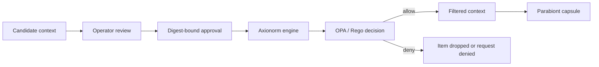

# Axionorm

**Agent policy as code.** Axionorm is a YAML-first specification for agent
authority and context boundaries, with an installable Python reference
implementation and an OPA/Rego decision backend.

## Status

v0.1.0 is an experimental reference implementation. It ships strict schemas,
digest-bound context review, a real OPA evaluator, and enforcement integrated
with [Parabiont Protocol](/parabiont) and [PARALAX MCP](/paralax).

It is **not** a complete semantic DLP product, a compliance certification, or a
production security guarantee. Treat it as a working reference for how agent
authority should be expressed and enforced.

## What It Decides

Axionorm answers two questions before context or tools move:

1. **Context:** which reviewed items may leave the session, given the declared
   topics, kinds, labels, size limits, and content checks?
2. **Tools:** may this named tool run, with this file extension, this byte size,
   and a valid scope?

Both decisions go through OPA. Unknown tools, invalid reviews, duplicate IDs,
oversized payloads, missing OPA, and unexpected evaluator output all **fail
closed**.

## How the Pieces Fit

- **Candidate** is a JSON document of items an agent proposes to carry.
- **Review** is an operator manifest that records the SHA-256 digest of each
  approved item.
- **Policy** is a strict YAML document with context and tool rules.
- **OPA** evaluates `action=context` and `action=tool` requests against the
  packaged Rego rules.

Editing an approved item changes its digest and invalidates the approval. The
reviewer cannot approve a whole chat export by accident and expect the content
to stay approved after edits.

## Design Boundaries

- YAML describes authority. It does not execute installation stages.
- Pattern matching is defense in depth, not a semantic classifier. A reviewer
  can still approve mislabeled sensitive prose.
- OPA decides allow or deny per item. It does not remove text, infer private
  facts, or enforce anything inside a provider account.
- There is no permissive fallback when OPA times out or returns something
  unexpected.

## Read Next

- [Install and run](./install.md) the reference implementation.
- [Policy schema](./policy-schema.md) for every field and limit.
- [OPA backend](./opa.md) for how decisions are evaluated.
- [Worked example](./examples.md) for a complete policy you can copy.

Source: [github.com/amiencoy/axionorm](https://github.com/amiencoy/axionorm)
