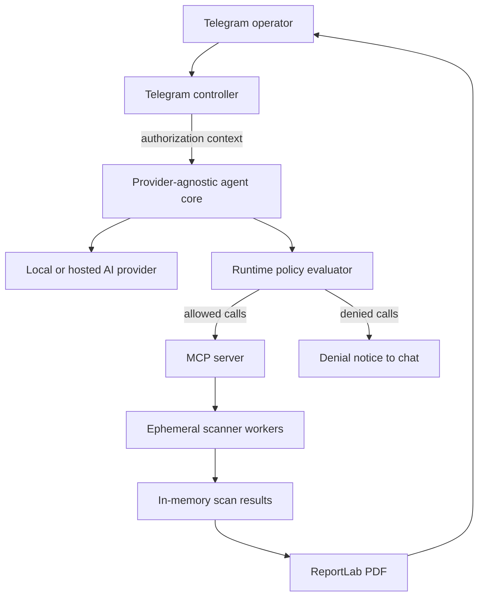

---
sidebar_label: 'Architecture'
---

# Architecture Overview

Lophiarch separates interaction, provider-agnostic AI tool selection, runtime
policy enforcement, MCP registration, scanner execution, and reporting into
distinct components.

## Components

### Telegram Controller

`src/bot.py` is the ChatOps entrypoint. It enforces the operator gate, handles
`/start`, `/help`, `/authorize`, `/scope`, and `/revoke`, and keeps the
per-chat authorization context.

When a message is not a command, the controller sends it to the agent core,
receives a plan of tool calls with policy decisions, reports every denied call,
and executes the approved ones. Independent scanners run concurrently; the PDF
call is deferred until every requested scan finishes.

### Provider-Agnostic Agent Core

The implementation under `src/agent_core/`:

- Discovers MCP tools dynamically through an MCP stdio transport.
- Filters discovered tools against the tools allowed by policy.
- Converts MCP schemas to OpenAI-compatible function-tool definitions.
- Sends the user request and available tools to the selected provider.
- Evaluates every returned tool call through `src/agent_core/policy.py`.
- Completes explicit multi-tool requests when a model returns only a partial
  plan, without overriding a denial.
- Normalizes tool-call responses before execution through the active MCP
  session.

Provider presets currently cover Ollama, vLLM, LM Studio, llama.cpp, and Gemini.
The `openai-compatible` option supports other local or hosted services by using
a custom chat-completions endpoint. Ollama with Qwen is the default, so a cloud
model is not required.

### Runtime Policy

`src/agent_core/policy.py` evaluates `src/config/agent-policy.yaml` before any
tool reaches MCP. It checks, in order:

1. The tool is not on `forbidden_tools`.
2. The tool is on the allowlist when `default_deny` is enabled.
3. `requires_approval` tools have an approved authorization context.
4. Target arguments are present for tools that declare `target_fields`.
5. A declared scope exists when `require_declared_scope` is enabled.
6. Every target is inside the authorized host, domain, or CIDR scope.

A failure produces a denial code such as `SCOPE_REQUIRED`, `OUT_OF_SCOPE`, or
`APPROVAL_REQUIRED`. The controller reports it and does not execute the call.
See [Authorization and Scope](./authorization-and-scope.md).

### MCP Server

`src/mcp_server.py` registers the current tool surface:

- `execute_subdomain_recon`
- `execute_nmap`
- `execute_nuclei`
- `execute_ffuf`
- `create_pdf_report`

It also keeps scan results in process memory until a PDF is generated. After a
successful report, the in-memory results are cleared.

### Scanner Workers

Scanner modules use asynchronous subprocesses to start disposable containers:

- `lophiarch-nmap:latest`
- `lophiarch-ffuf:latest`
- `lophiarch-nuclei:latest`
- `projectdiscovery/subfinder:latest`
- `projectdiscovery/dnsx:latest`

The `--rm` flag removes workers after execution. The worker images and Docker
daemon remain outside the main application process.

### Execution Order

The controller sorts approved calls for stable display order:

1. Subdomain reconnaissance
2. Nmap
3. Nuclei
4. Ffuf
5. PDF report generation

Sorting no longer defines execution order. All approved scanner calls start
concurrently with `asyncio.gather`, and `create_pdf_report` runs only after the
scanner batch finishes, so the report includes every requested scan. A failed
scanner does not cancel the others; its error is returned as a result string.

### Reporting

`src/modules/report_generator.py` converts accumulated scan data into a
ReportLab PDF under `generated_reports/`, named
`Lophiarch_Report_<timestamp>.pdf`. The Telegram controller sends the resulting
file back to the user.

## Trust Boundaries

- Telegram input crosses into the AI and tool-selection layer.
- A remote AI provider receives prompts and tool schemas; a local provider keeps
  this traffic within the operator-controlled network.
- An optional Gemini fallback receives the same prompt and tool schemas when the
  primary provider fails.
- Scanner arguments cross into Docker CLI commands.
- Mounting `/var/run/docker.sock` gives the main container substantial control
  over the host Docker daemon.
- Scan results may contain sensitive infrastructure information.
- The current scan memory is process-local and not a durable database.
- Authorization state is process-local and cleared on restart.

Changing providers does not bypass MCP validation, runtime policy, or the
operator's responsibility to review security boundaries.
