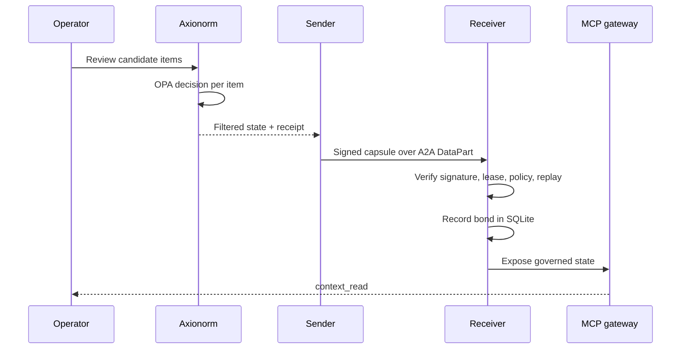

# Parabiont Protocol

An open-protocol initiative for persistent, governed agent attachment. Formerly
**AIPP (AI Parabiosis Protocol)**.

## Status

v0.1.2 provides an experimental **context-carrier profile** over an official A2A
SDK transport. It includes:

- Ed25519 signatures over the capsule.
- Purpose and audience binding.
- Expiry and replay protection.
- Local revocation.
- Explicit HTTP-server dependencies.
- Refreshed security dependencies.

This is one profile within a wider attachment initiative, not a complete
persistent-agent SDK.

## The Problem

Moving context between agents usually means one of two bad options: paste the
whole conversation into a new model, or build a bespoke integration that trusts
whatever the sender provides.

Parabiont defines a third path. The sender reviews and filters context, signs a
small capsule with a purpose and a lease, and the receiver re-checks it against
its own policy before exposing anything to the destination agent.

## Mechanism

1. Prepare and review a project context candidate locally.
2. Axionorm invokes OPA per item; rejected content never enters the outgoing
   capsule.
3. Parabiont signs the filtered capsule and sends one A2A DataPart.
4. The receiver authenticates the issuer, checks current policy and lease, and
   records the bond in SQLite.
5. A governed MCP gateway exposes that state to the destination agent.

## Protocol Positioning

- The sender and receiver are A2A agents around source and destination
  workflows. Neither ChatGPT nor the Gemini consumer app is claimed to expose a
  native A2A endpoint.
- This profile pins **A2A 0.3.0** and `a2a-sdk==0.3.26`. It does not claim A2A
  1.0 conformance.
- Parabiont is an extension, not a fork of the wire protocol.

## Boundaries

- Expiry and revocation cannot erase context already delivered to a model.
- Remote TLS and authentication are not part of the supported profile.
- Distributed revocation, persistent A2A tasks, and round-trip reconciliation
  remain future work.
- The supported deployment is loopback-only.
- Licensing for the specification and implementation remains to be selected.

## Read Next

- [Message model](./message-model.md) for the capsule and envelope shape.
- [Governance](./governance.md) for review, leases, and revocation.
- [Adoption](./adoption.md) for running the reference implementation.

Source: [github.com/amiencoy/parabiont-protocol](https://github.com/amiencoy/parabiont-protocol)
