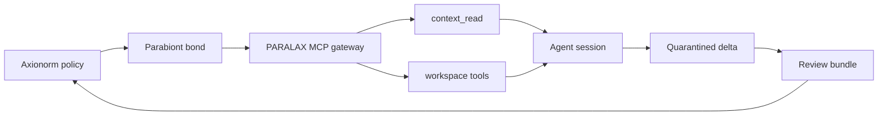

# PARALAX MCP

Policy-gated MCP tools and desktop integration for [Axionorm](/axionorm) and
[Parabiont Protocol](/parabiont).

## Status

Experimental v0.1.2. The local OPA → signed A2A → MCP flow works, and so does
the quarantined MCP → context-delta → Axionorm return path without automatic
memory promotion.

Gemini CLI and AionUi configuration is generated at install time. Live login,
entitlement, and desktop behavior must still be checked on the target machine.

This is an initial integration, not the full multi-agent orchestrator.

## What It Adds

Axionorm decides. Parabiont carries. PARALAX exposes the result to an agent
through MCP with the same policy enforced at the tool boundary.

- Tools are discovered through policy, not through optimism.
- Denied tools are omitted from discovery and checked again during execution.
- Output is scanned before it reaches the agent.
- Model-written deltas stay quarantined until an operator reviews them.

## Components

## Tool Surface

| Tool | Behavior |
| --- | --- |
| `context_read` | Checks policy, expiry, and revocation on every read. |
| `workspace_list` | Lists explicitly approved exported filenames. |
| `workspace_read` | Reads a regular non-symlink file with a matching reviewed digest, then scans output. |
| `workspace_write` | Optional create-only artifact output; disabled by default; no overwrite or execution. |

No shell, package installer, unrestricted browser, or arbitrary filesystem tool
is exposed.

## Read Next

- [Install](./install.md) with the combined installer or WSL2 bootstrap.
- [Tools](./tools.md) for the policy boundary at the MCP layer.
- [Return path](./return-path.md) for the quarantined delta workflow.

Source: [github.com/amiencoy/paralax-mcp](https://github.com/amiencoy/paralax-mcp)
